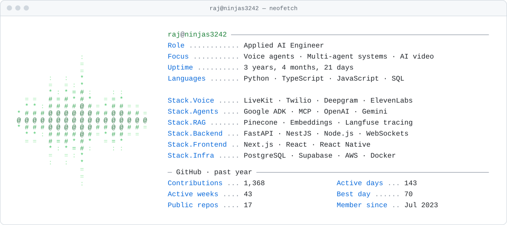
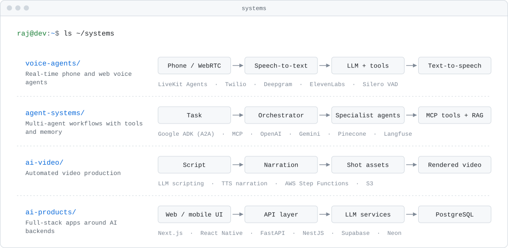

<picture>
  <source media="(prefers-color-scheme: dark) and (max-width: 600px)" srcset="assets/card-dark-mobile.svg">
  <source media="(max-width: 600px)" srcset="assets/card-light-mobile.svg">
  <source media="(prefers-color-scheme: dark)" srcset="assets/card-dark.svg">
  
</picture>

<picture>
  <source media="(prefers-color-scheme: dark) and (max-width: 600px)" srcset="assets/systems-dark-mobile.svg">
  <source media="(max-width: 600px)" srcset="assets/systems-light-mobile.svg">
  <source media="(prefers-color-scheme: dark)" srcset="assets/systems-dark.svg">
  
</picture>
