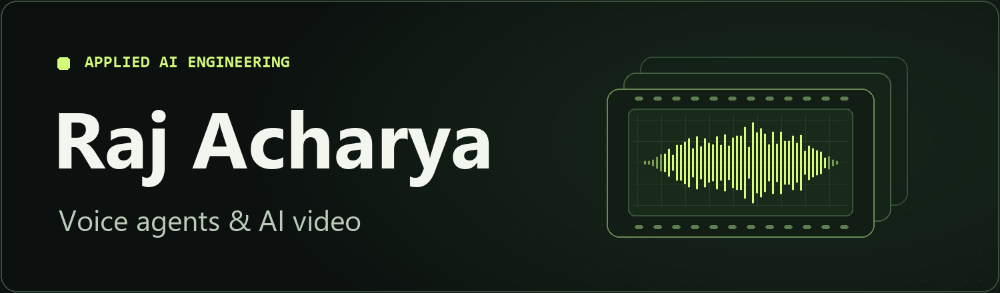

I build **real-time voice agents** and the systems around them, from telephony and tool calls to call monitoring. I also build **AI video pipelines** that take narration and shot assets through to a finished render.

## Selected projects

### [Truck Bot](https://github.com/ninjas3242/Truck_bot)

A multilingual sales assistant demo for horse trucks, with product recommendations and lead qualification.

### [Document Analyzer](https://github.com/ninjas3242/Dep_Law_bot)

A Streamlit app for batch analysis of HTML documents with Gemini or local DeepSeek models via Ollama.

### [HealthVault](https://github.com/PARSHAV529/Health-Vault)

I contributed to this team-built health records app using React, Node.js, MongoDB, and Twilio.
