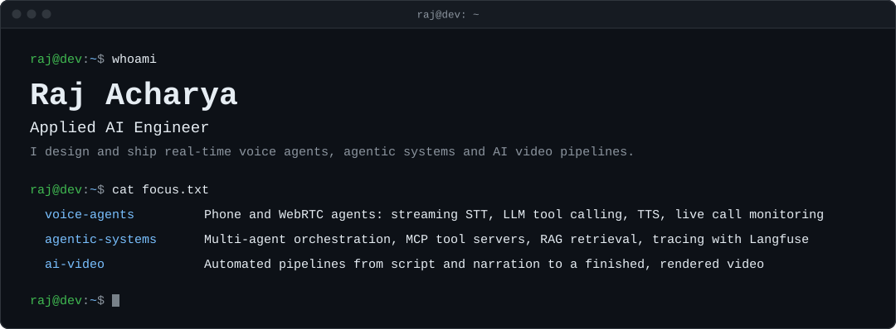
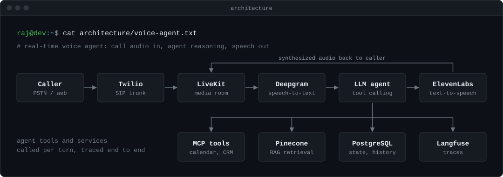

<picture>
  <source media="(max-width: 600px)" srcset="assets/intro-mobile.svg">
  
</picture>

<picture>
  <source media="(max-width: 600px)" srcset="assets/architecture-mobile.svg">
  
</picture>

<picture>
  <source media="(max-width: 600px)" srcset="assets/stack-mobile.svg">
  
</picture>

<!-- activity:start -->
<picture>
  <source media="(max-width: 600px)" srcset="assets/activity-mobile.svg">
  
</picture>
<!-- activity:end -->
